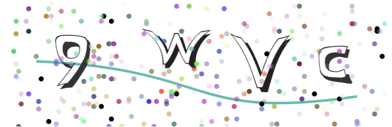
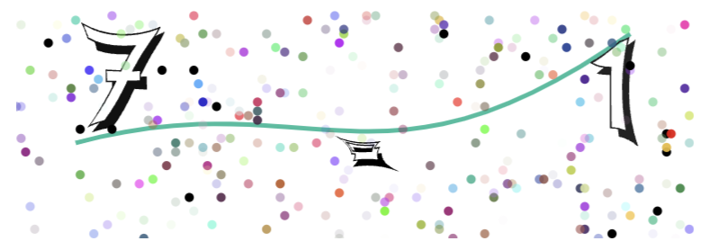

# Go SVG Captcha

> A lightweight, fast, and highly customizable SVG-based CAPTCHA generator for Go applications. Generate beautiful, scalable CAPTCHAs without any image rendering dependencies.

<div align="center">
  
[](https://pkg.go.dev/github.com/reu98/go-svg-captcha)
[](https://github.com/reu98/go-svg-captcha/actions?workflow=go-svg-captcha-ci)
[](https://codecov.io/gh/reu98/go-svg-captcha)
[](https://goreportcard.com/report/github.com/reu98/go-svg-captcha)
[](https://opensource.org/licenses/MIT)
[](https://go.dev/)

</div>

## Table of Contents

- [Features](#features)
- [Why This Package?](#why-this-package)
- [Installation](#installation)
- [Quick Start](#quick-start)
- [Usage Examples](#usage-examples)
  - [Basic Text CAPTCHA](#basic-text-captcha)
  - [Math CAPTCHA](#math-captcha)
  - [Advanced Configuration](#advanced-configuration)
- [API Reference](#api-reference)
- [Configuration Options](#configuration-options)
- [Sample Images](#sample-images)
- [Performance](#performance)
- [Security Considerations](#security-considerations)
- [Compatibility](#compatibility)
- [Contributing](#contributing)
- [Changelog](#changelog)
- [License](#license)
- [Roadmap](#roadmap)

## Features

✨ **Lightweight & Fast** - No external image processing libraries required  
🎨 **Highly Customizable** - Full control over size, colors, fonts, noise, and curves  
📐 **SVG-Based** - Scalable vector graphics for crisp display at any resolution  
🔢 **Multiple Types** - Support for both text and mathematical CAPTCHAs  
🎯 **Easy Integration** - Simple API with sensible defaults  
🌈 **Color Support** - Grayscale or full color mode with automatic contrast adjustment  
🔤 **Custom Fonts** - Use your own TTF fonts or the included default  
🛡️ **Distortion & Noise** - Configurable curves and noise for enhanced security  
🎭 **Inverse Mode** - Light text on dark backgrounds  
⚙️ **Zero Dependencies** - Minimal external dependencies for easy maintenance

## Why This Package?

Unlike other CAPTCHA solutions that rely on heavy image rendering libraries, `go-svg-captcha` generates pure SVG markup. This approach offers several advantages:

- **No ImageMagick or GD required** - Pure Go implementation
- **Smaller file sizes** - SVG is typically more compact than raster images
- **Perfect scaling** - Looks sharp on any screen resolution (including Retina displays)
- **Easy styling** - Can be customized with CSS if needed
- **Better performance** - No image encoding/decoding overhead
- **Server-friendly** - Lower CPU and memory usage

## Installation

```bash
    go get -u github.com/reu98/go-svg-captcha
```

## Quick Start

```go
package main

import (
    "fmt"
    "log"

    captcha "github.com/reu98/go-svg-captcha"
)

    func main() {
    // Create a text CAPTCHA with default settings
    result, err := captcha.CreateByText(captcha.OptionText{})
        if err != nil {
        log.Fatal(err)
    }

    fmt.Printf("CAPTCHA Text: %s\n", result.Text)
    fmt.Printf("CAPTCHA SVG: %s\n", result.Data)
}
```

## Usage Examples

### Basic Text CAPTCHA

Generate a simple text-based CAPTCHA with default settings:

```go
import captcha "github.com/reu98/go-svg-captcha"

// Default: 4 characters, 150x50px, grayscale
result, err := captcha.CreateByText(captcha.OptionText{})
if err != nil {
    log.Fatal(err)
}

// Store result.Text in session for validation
// Serve result.Data as HTML
```

### Math CAPTCHA

Generate a mathematical challenge CAPTCHA:

```go
// Creates math problems like "5 + 3" or "9 - 4"
result, err := captcha.CreateByMath(captcha.OptionMath{})
if err != nil {
    log.Fatal(err)
}

// result.Text contains the answer (e.g., "8" or "5")
// result.Data contains the SVG with the equation
```

### Advanced Configuration

#### Colorful CAPTCHA with Custom Size

```go
result, err := captcha.CreateByText(captcha.OptionText{
    Size:     6,           // 6 characters
    Width:    200,         // 200px wide
    Height:   80,          // 80px tall
    IsColor:  true,        // Use colors instead of grayscale
    Curve:    2,           // Add 2 distortion curves
    FontSize: 20,          // Larger font
})
```

#### Dark Mode CAPTCHA

```go
import "image/color"

result, err := captcha.CreateByText(captcha.OptionText{
    IsInverse:       true,                    // Light text on dark bg
    BackgroundColor: color.RGBA{30, 30, 30, 255}, // Dark gray background
    IsColor:         true,
})
```

#### Custom Character Set

```go
result, err := captcha.CreateByText(captcha.OptionText{
    CharactersPreset: "ABCDEFGHIJKLMNOPQRSTUVWXYZ0123456789", // Uppercase + numbers only
    IgnoreCharacters: "O0I1",                                   // Remove confusing chars
    Size:            5,
})
```

#### Custom Font

```go
result, err := captcha.CreateByText(captcha.OptionText{
    FontPath: "/path/to/your/font.ttf",
})
```

#### Math CAPTCHA with Range

```go
result, err := captcha.CreateByMath(captcha.OptionMath{
    MathMin:      10,                           // Minimum number
    MathMax:      99,                           // Maximum number
    MathOperator: captcha.MathOperatorPlus,     // Force addition only
    Width:        250,
    Height:       100,
    IsColor:      true,
})
```

#### Pre-set Text CAPTCHA

```go
// Generate CAPTCHA with specific text (useful for testing)
result, err := captcha.CreateByText(captcha.OptionText{
    Text: "TEST123",
})
```

### Web Server Integration Example

```go
package main

import (
    "encoding/json"
    "net/http"

    "github.com/gorilla/sessions"
    captcha "github.com/reu98/go-svg-captcha"
)

var store = sessions.NewCookieStore([]byte("secret-key"))

func captchaHandler(w http.ResponseWriter, r *http.Request) {
    session, _ := store.Get(r, "session")

    result, err := captcha.CreateByText(captcha.OptionText{
        Size:    5,
        IsColor: true,
        Curve:   2,
    })
    if err != nil {
        http.Error(w, err.Error(), http.StatusInternalServerError)
        return
    }

    // Store answer in session
    session.Values["captcha"] = result.Text
    session.Save(r, w)

    // Return SVG
    w.Header().Set("Content-Type", "application/json")
    json.NewEncoder(w).Encode(map[string]string{
        "svg": result.Data,
    })
}

func validateHandler(w http.ResponseWriter, r *http.Request) {
    session, _ := store.Get(r, "session")
    userInput := r.FormValue("captcha")

    correctAnswer := session.Values["captcha"].(string)

    if userInput == correctAnswer {
        w.Write([]byte("Valid!"))
    } else {
        w.Write([]byte("Invalid!"))
    }

    // Clear captcha after validation
    delete(session.Values, "captcha")
    session.Save(r, w)
}
```

## API Reference

### Types

#### `Result`

```go
type Result struct {
    Text string // The CAPTCHA answer (random string or math result)
    Data string // SVG markup as HTML string
}
```

### Functions

#### `CreateByText(option OptionText) (*Result, error)`

Generates a text-based CAPTCHA.

**Parameters:**

- `option` - Configuration for the text CAPTCHA (see `OptionText`)

**Returns:**

- `*Result` - Contains the CAPTCHA text and SVG data
- `error` - Error if generation fails

#### `CreateByMath(option OptionMath) (*Result, error)`

Generates a mathematical challenge CAPTCHA.

**Parameters:**

- `option` - Configuration for the math CAPTCHA (see `OptionMath`)

**Returns:**

- `*Result` - Contains the answer and SVG data
- `error` - Error if generation fails

## Configuration Options

### `OptionText`

| Field              | Type          | Default       | Description                                        |
| ------------------ | ------------- | ------------- | -------------------------------------------------- |
| `Size`             | `uint8`       | `4`           | Number of characters in CAPTCHA                    |
| `Width`            | `uint16`      | `150`         | Width in pixels                                    |
| `Height`           | `uint16`      | `50`          | Height in pixels                                   |
| `FontSize`         | `uint8`       | `16`          | Base font size (scaled internally)                 |
| `IsColor`          | `bool`        | `false`       | Use colors instead of grayscale                    |
| `IsInverse`        | `bool`        | `false`       | Light text on dark background                      |
| `Curve`            | `uint8`       | `1`           | Number of distortion curves                        |
| `BackgroundColor`  | `color.Color` | `Transparent` | Background color (enables `IsColor` automatically) |
| `IgnoreCharacters` | `string`      | `""`          | Characters to exclude (e.g., "O0I1")               |
| `FontPath`         | `string`      | `""`          | Path to custom TTF font                            |
| `CharactersPreset` | `string`      | `A-Za-z0-9`   | Available characters for generation                |
| `Text`             | `string`      | `""`          | Pre-set text (if empty, random text is generated)  |

### `OptionMath`

| Field             | Type           | Default       | Description                               |
| ----------------- | -------------- | ------------- | ----------------------------------------- |
| `Width`           | `uint16`       | `150`         | Width in pixels                           |
| `Height`          | `uint16`       | `50`          | Height in pixels                          |
| `FontSize`        | `uint8`        | `16`          | Base font size                            |
| `FontPath`        | `string`       | `""`          | Path to custom TTF font                   |
| `IsColor`         | `bool`         | `false`       | Use colors instead of grayscale           |
| `IsInverse`       | `bool`         | `false`       | Light text on dark background             |
| `Curve`           | `uint8`        | `1`           | Number of distortion curves               |
| `BackgroundColor` | `color.Color`  | `Transparent` | Background color                          |
| `MathOperator`    | `mathOperator` | Random        | `MathOperatorPlus` or `MathOperatorMinus` |
| `MathMin`         | `uint8`        | `1`           | Minimum value for operands                |
| `MathMax`         | `uint16`       | `9`           | Maximum value for operands                |

### Constants

```go
captcha.MathOperatorPlus   // "+" for addition
captcha.MathOperatorMinus  // "-" for subtraction
```

## Sample Images

### Text CAPTCHA



### Math CAPTCHA



## Performance

`go-svg-captcha` is designed for high performance with minimal overhead:

- **Fast Generation**: SVG generation is purely computational, no image encoding
- **Low Memory**: No image buffers or heavy processing
- **Concurrent Safe**: Can be used safely in concurrent web applications
- **Lightweight Output**: SVG files are typically smaller than equivalent PNG/JPEG

### Benchmarks

```bash
# Run benchmarks
go test -bench=. -benchmem
```

Typical performance on modern hardware:

- Text CAPTCHA generation: ~1-2ms per captcha
- Math CAPTCHA generation: ~1-2ms per captcha
- Memory allocation: <10KB per captcha

## Security Considerations

While this package provides good protection against automated bots, please keep these security best practices in mind:

### ✅ Recommended Practices

1. **Server-Side Validation**: Always validate CAPTCHA on the server side
2. **Single Use**: Invalidate CAPTCHA after one verification attempt (success or failure)
3. **Time Limits**: Set expiration times for CAPTCHAs (e.g., 5-10 minutes)
4. **Secure Storage**: Store CAPTCHA answers in secure server-side sessions, not cookies
5. **Rate Limiting**: Implement rate limiting to prevent brute force attacks
6. **HTTPS**: Always serve CAPTCHAs over HTTPS
7. **Sufficient Complexity**: Use at least 4-6 characters with distortion curves

### ⚠️ Limitations

- **Not OCR-Proof**: While distortion helps, determined attackers with ML models may bypass simple CAPTCHAs
- **Accessibility**: CAPTCHAs can be challenging for visually impaired users (consider audio alternatives)
- **User Experience**: Balance security with usability

### Enhanced Security Example

```go
// Enhanced security configuration
result, err := captcha.CreateByText(captcha.OptionText{
    Size:             6,              // Longer text
    IsColor:          true,           // Color variation
    Curve:            3,              // More distortion
    IgnoreCharacters: "O0I1l",        // Remove confusing chars
})
```

### Session Management Example

```go
type CaptchaSession struct {
    Answer    string
    CreatedAt time.Time
    Attempts  int
}

func validateCaptcha(sessionAnswer *CaptchaSession, userInput string) bool {
    // Check expiration (10 minutes)
    if time.Since(sessionAnswer.CreatedAt) > 10*time.Minute {
        return false
    }

    // Limit attempts
    sessionAnswer.Attempts++
    if sessionAnswer.Attempts > 3 {
        return false
    }

    // Case-insensitive comparison
    return strings.EqualFold(sessionAnswer.Answer, userInput)
}
```

## Compatibility

### Requirements

- **Go Version**: 1.21.4 or higher (uses Go embed feature)
- **Platforms**: All platforms supported by Go (Linux, macOS, Windows)
- **Browsers**: All modern browsers with SVG support (IE9+, Chrome, Firefox, Safari, Edge)

### Dependencies

This package has minimal dependencies:

- `github.com/tdewolff/canvas` - For font rendering and path generation

To check for dependency updates:

```bash
go list -m -u all
```

## Contributing

We welcome contributions! Here's how you can help:

### Ways to Contribute

- 🐛 **Report Bugs** - Open an issue with reproduction steps
- 💡 **Suggest Features** - Share your ideas for improvements
- 📝 **Improve Documentation** - Help make the docs clearer
- 🔧 **Submit Pull Requests** - Fix bugs or add features

### Development Setup

```bash
# Clone the repository
git clone https://github.com/reu98/go-svg-captcha.git
cd go-svg-captcha

# Install dependencies
go mod download

# Run tests
go test ./...

# Run tests with coverage
go test -cover ./...

# Run benchmarks
go test -bench=. -benchmem
```

### Code Standards

- Follow Go best practices and idioms
- Run `go fmt` before committing
- Add tests for new features
- Update documentation as needed
- Keep commits atomic and well-described

For more details, see [CONTRIBUTING.md](CONTRIBUTING.md)

## Troubleshooting

### Common Issues

#### CAPTCHA Not Displaying

**Problem**: SVG not rendering in browser

**Solution**: Ensure you're serving the SVG with proper content type:

```go
w.Header().Set("Content-Type", "image/svg+xml")
w.Write([]byte(result.Data))
```

#### Font Loading Errors

**Problem**: Custom font fails to load

**Solution**:

- Verify the font file path is correct
- Ensure the font file is a valid TTF format
- Check file permissions

#### Characters Not Random Enough

**Problem**: CAPTCHA seems predictable

**Solution**:

- Ensure you're using `math/rand.Seed()` or Go 1.20+ automatic seeding
- Add more distortion curves
- Increase character count

#### Performance Issues

**Problem**: CAPTCHA generation is slow

**Solution**:

- Check for font loading on every request (cache fonts if possible)
- Reduce complexity (fewer curves, smaller size)
- Profile your application with `pprof`

### Getting Help

- 📚 [Documentation](https://pkg.go.dev/github.com/reu98/go-svg-captcha)
- 💬 [Open an Issue](https://github.com/reu98/go-svg-captcha/issues)
- 📧 Check existing issues for similar problems

## Changelog

See [CHANGELOG.md](CHANGELOG.md) for version history and release notes.

### Recent Updates

- **v1.1.0** (2024-03-26): Added noise generation and custom font support
- **v1.0.5** (2023-12-22): Documentation improvements and fixes
- **v1.0.4** (2023-12-21): Initial release

## License

This project is licensed under the MIT License - see the [LICENSE](LICENSE) file for details.

## Acknowledgments

- Font rendering powered by [tdewolff/canvas](https://github.com/tdewolff/canvas)
- Inspired by [svg-captcha](https://github.com/produck/svg-captcha) for Node.js

## Roadmap

### Completed ✅

- [x] Finish [Documentation](https://pkg.go.dev/github.com/reu98/go-svg-captcha)
- [x] Custom font support
- [x] Noise generation
- [x] Math CAPTCHA support

### Planned 🚀

- [ ] Generate multiple CAPTCHAs in batch
- [ ] Export to PNG/JPEG format
- [ ] Cloud storage integration (S3, GCS)
- [ ] CAPTCHA storage/caching system for API usage
- [ ] Audio CAPTCHA for accessibility
- [ ] More math operations (multiplication, division)
- [ ] Animated SVG CAPTCHAs
- [ ] Chinese character support
- [ ] RESTful API service example

### Ideas 💡

- [ ] CAPTCHA difficulty levels
- [ ] Pre-generated CAPTCHA pool
- [ ] WebAssembly support
- [ ] Puzzle-based CAPTCHAs
- [ ] Integration with popular web frameworks (Gin, Echo, Fiber)

## Star History

If you find this project useful, please consider giving it a ⭐ on GitHub!

---

<div align="center">

**[Documentation](https://pkg.go.dev/github.com/reu98/go-svg-captcha)** |
**[Examples](examples/)** |
**[Report Bug](https://github.com/reu98/go-svg-captcha/issues)** |
**[Request Feature](https://github.com/reu98/go-svg-captcha/issues)**

Made with ❤️ by [reu98](https://github.com/reu98)

</div>
